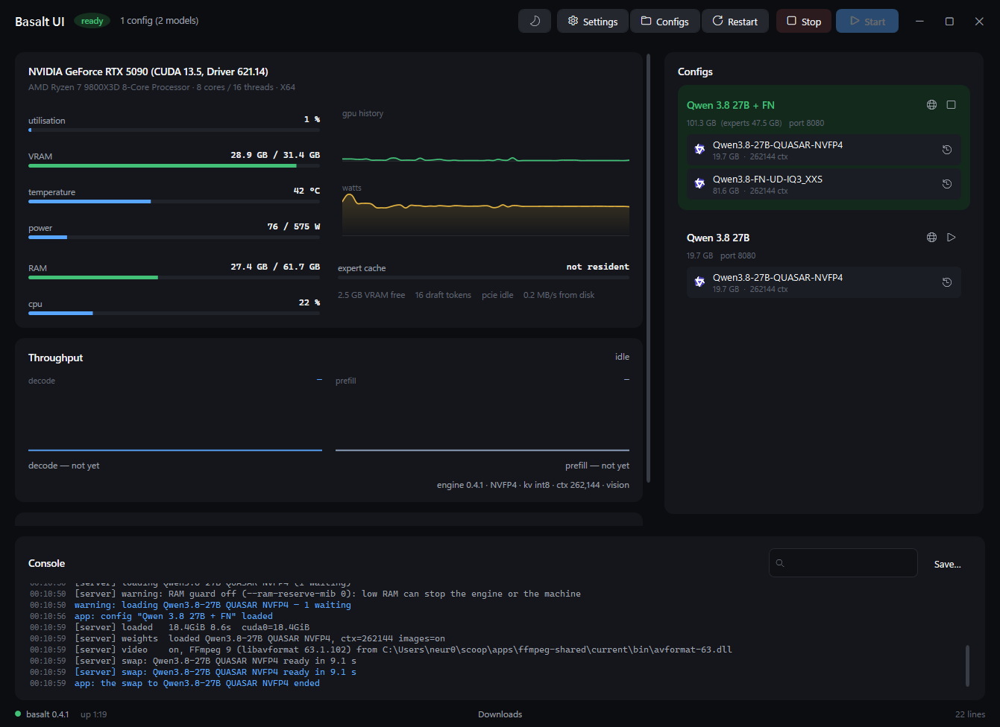

# Basalt UI

A Windows tray app around [basalt](https://github.com/jesdga95/basalt): run the inference server
from the tray instead of a terminal.



- **Named configs** — whole basalt documents (models, server, engine, raw JSON), loaded and stopped
  with a click, several running at once on their own ports; the dashboard shows every config, running
  or not.
- **The machine as Windows counts it** — RAM and VRAM from Task Manager's own sources, GPU
  utilisation, temperature and power, throughput sparklines and per-model request history.
- **Before you commit 80 GB** — a load preview prices a model against the free VRAM, RAM and disk
  before anything loads, and says what would stream from the SSD.
- **Model downloads** — search Hugging Face, pull `.basalt` / `.gguf` packs over many connections,
  resumable, checked against the published sha256.
- **Console** — basalt's output in a selectable log pane, filterable and saveable.

Dark and light themes follow Windows' own setting; every window, tray menu and dialog is drawn by
the app itself.

## Install

Download `BasaltUI-<version>-setup.exe` from the
[latest release](https://github.com/hvmzx/Basalt-UI/releases/latest) and run it. It installs per-user
(no admin needed), adds a Start menu shortcut, and appears in Settings → Apps for uninstalling. A
portable single-file `BasaltUI.exe` is on the release page too, if you would rather not install.

Everything the app keeps — settings, configs, logs — lives in `%APPDATA%\BasaltUI`; basalt itself is
downloaded from inside the app the first time it starts. The tray icon lands in the taskbar-corner
overflow; drag it out once if you want it beside the clock.

## Releases

Every `v*` tag pushed builds both exes and publishes them as a GitHub release. To cut a version:

```powershell
powershell -ExecutionPolicy Bypass -File release.ps1              # next patch version
powershell -ExecutionPolicy Bypass -File release.ps1 -Part minor   # next minor version
```
